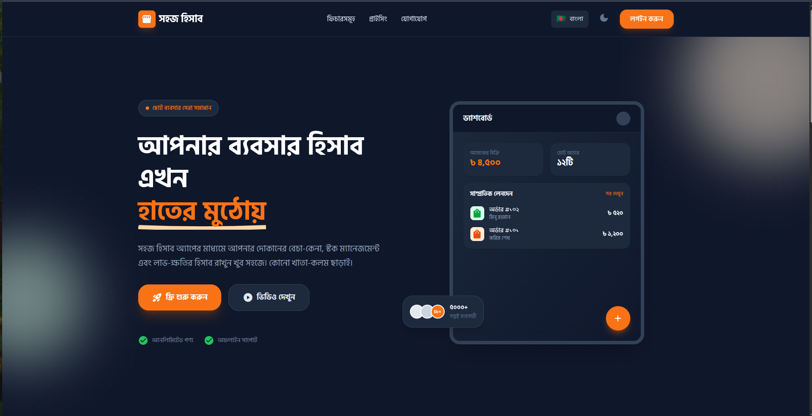

# Shohoj Hishab

[](https://github.com/yourusername/shohoj-hishab)
[](https://opensource.org/licenses/MIT)

A modern POS (Point of Sale) and accounting system built specifically for small businesses in Bangladesh. Built with a monorepo architecture using Turbo, pnpm, TypeScript, Vite, and NestJS.

[Live Demo](http://localhost:3000) | [Documentation](./docs)



## Overview

Shohoj Hishab (Easy Accounting) is a bilingual (Bengali and English) web application designed to help small business owners manage their daily operations including billing, stock management, and profit tracking. The application features a modern, responsive design with dark mode support.

**Key Features:**
- Bilingual support (Bengali primary, English secondary)
- Easy billing with digital receipts
- Stock alerts and management
- Payment integration (bKash, Nagad, Rocket)
- Real-time profit/loss tracking
- Cloud backup
- Dark/Light mode toggle
- Responsive design for mobile and desktop

## Project Structure

This is a monorepo managed with Turborepo and pnpm workspaces.

```
shohoj-hishab/
├── apps/
│   ├── api/                 # NestJS backend API (port 3001)
│   └── web/                 # Vite + React frontend (port 3000)
├── packages/
│   ├── tailwind-config/     # Shared Tailwind CSS configuration
│   └── typescript-config/   # Shared TypeScript configurations
├── docs/
│   ├── design-system.html   # Design system documentation
│   ├── screenshots/         # Application screenshots
│   └── video.md             # Promotional video script
├── package.json
├── turbo.json
└── pnpm-workspace.yaml
```

## Technology Stack

### Frontend
- React 19 with TypeScript
- Vite 6 for build tooling
- Tailwind CSS 4 for styling
- i18next for internationalization
- Material Icons Round for iconography

### Backend
- NestJS 11 with TypeScript
- RESTful API architecture
- CORS enabled

### Development Tools
- Turborepo for monorepo management
- pnpm workspaces for package management
- ESLint for code linting
- TypeScript for type safety

## Design System

### Color Palette
| Color | Hex | Usage |
|-------|-----|-------|
| Primary | `#f97316` | Buttons, links, accents |
| Background Light | `#f8fafc` | Light mode background |
| Background Dark | `#0f172a` | Dark mode background |
| Success | `#22c55e` | Success states |
| Warning | `#facc15` | Warnings |
| Error | `#ef4444` | Errors |

### Typography
- **Primary Font**: Hind Siliguri (Bengali)
- **Secondary Font**: Plus Jakarta Sans (English)
- **Scale**: 36px (H1), 24px (H2), 16px (Body)

### Border Radius
- Default: 12px
- Large: 16px
- Extra Large: 24px

## Getting Started

### Prerequisites
- Node.js >= 20
- pnpm >= 9.15.0

### Installation

1. Clone the repository
```bash
git clone https://github.com/yourusername/shohoj-hishab.git
cd shohoj-hishab
```

2. Install dependencies
```bash
pnpm install
```

3. Start development servers
```bash
pnpm dev
```

4. Open your browser
- Web App: http://localhost:3000
- API: http://localhost:3001

### Available Scripts

| Command | Description |
|---------|-------------|
| `pnpm dev` | Start all development servers |
| `pnpm build` | Build all packages for production |
| `pnpm lint` | Run ESLint on all packages |
| `pnpm typecheck` | Run TypeScript type checking |
| `pnpm clean` | Clean all build outputs |

## Features

### Billing System
- Quick 3-click billing process
- Digital receipt generation
- SMS invoice delivery
- Print support

### Stock Management
- Real-time stock tracking
- Low stock alerts
- Sales analytics and reports
- Product categorization

### Payment Integration
- bKash integration
- Nagad support
- Rocket payments
- Digital transaction records

### User Interface
- Responsive design
- Dark/Light mode toggle
- Language switcher (Bangla/English)
- Smooth scroll navigation
- Video modal for promotional content

## UI Components

All reusable components are located in `apps/web/src/components/`:

```tsx
import { Button, Card, Input, Icon, VideoModal } from './components'

function Example() {
  const [isModalOpen, setIsModalOpen] = useState(false)
  
  return (
    <Card shadow="xl" className="p-6">
      <Icon name="storefront" className="text-primary" />
      <Input icon="search" placeholder="Search products..." />
      <Button variant="primary" onClick={() => setIsModalOpen(true)}>
        Watch Video
      </Button>
      <VideoModal 
        isOpen={isModalOpen} 
        onClose={() => setIsModalOpen(false)}
        videoSrc="/promo-video.mp4"
      />
    </Card>
  )
}
```

### Available Components
- **Button**: Primary, Secondary, Outline, Ghost variants
- **Card**: Flexible container with customizable shadows
- **Input**: Form input with icon support and validation
- **Toggle**: Animated switch component
- **Icon**: Material Icons wrapper
- **Navbar**: Navigation bar with theme and language toggles
- **VideoModal**: Modal video player with auto-play

## Dark Mode

The application supports both light and dark themes. The theme is controlled by the `dark` class on the document root element.

```tsx
// Toggle dark mode
document.documentElement.classList.toggle('dark')
```

Theme preference is persisted in localStorage and automatically applied on page load.

## Internationalization

The application supports two languages:
- **Bengali (Bangla)**: Primary language
- **English**: Secondary language

Translation files are located in `apps/web/src/i18n/locales/`:
- `bn.json` - Bengali translations
- `en.json` - English translations

Language preference is persisted in localStorage.

## Deployment

### Build for Production
```bash
pnpm build
```

This will create production builds in:
- `apps/web/dist/` - Frontend static files
- `apps/api/dist/` - Backend compiled code

### Serve Production Build
```bash
# Frontend
cd apps/web && pnpm preview

# Backend
cd apps/api && pnpm start:prod
```

## Contributing

We welcome contributions! Please follow these steps:

1. Fork the repository
2. Create a feature branch (`git checkout -b feature/your-feature`)
3. Commit your changes (`git commit -m 'Add your feature'`)
4. Push to the branch (`git push origin feature/your-feature`)
5. Open a Pull Request

Please ensure your code:
- Passes all linting checks (`pnpm lint`)
- Passes type checking (`pnpm typecheck`)
- Follows the existing code style
- Includes appropriate tests

## License

This project is licensed under the MIT License - see the [LICENSE](LICENSE) file for details.

## Credits

- Design system inspired by modern POS interfaces
- Built for the small business community in Bangladesh
- Icons provided by Material Icons Round
- Fonts: Hind Siliguri and Plus Jakarta Sans

## Support

For support, please contact:
- Email: support@shohojhishab.com
- Phone: +880 1234 567890
- Address: Banani, Dhaka-1213, Bangladesh

---

Copyright 2026 Shohoj Hishab. All rights reserved.
